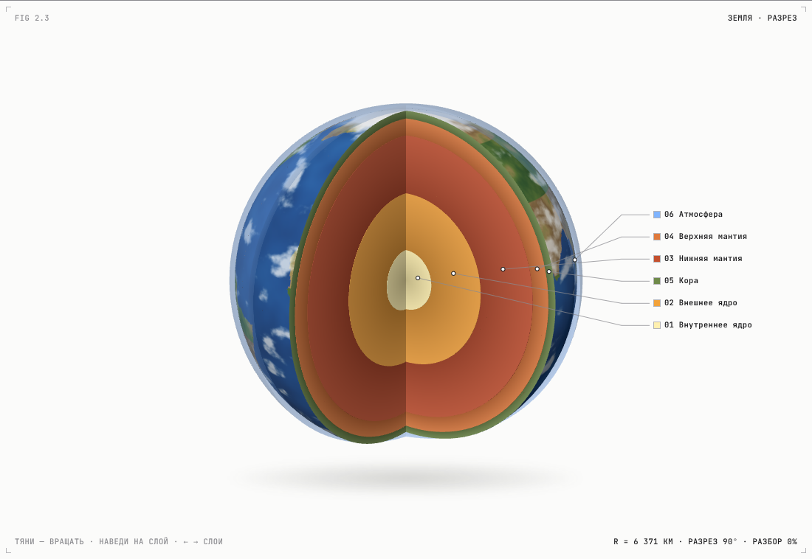
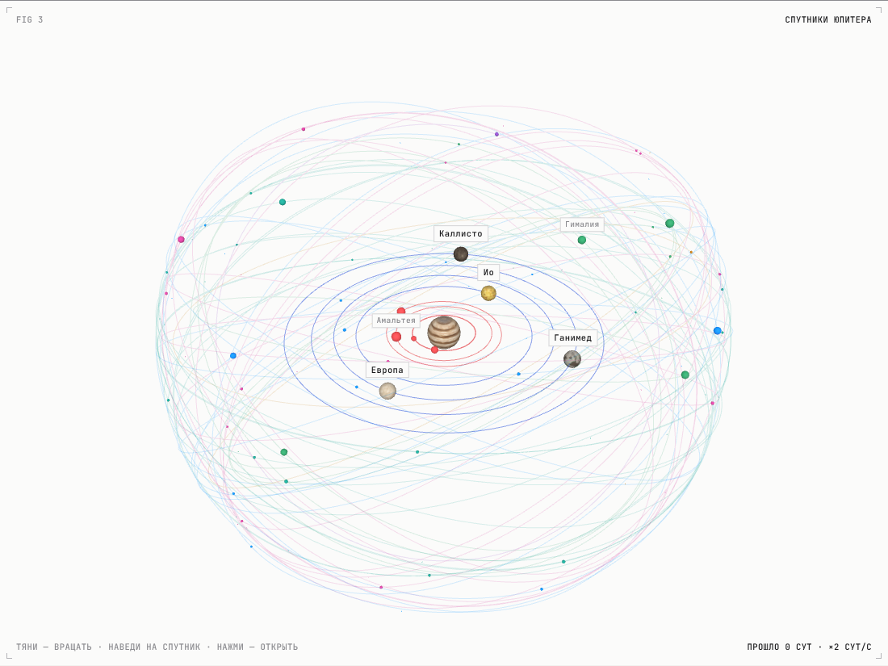
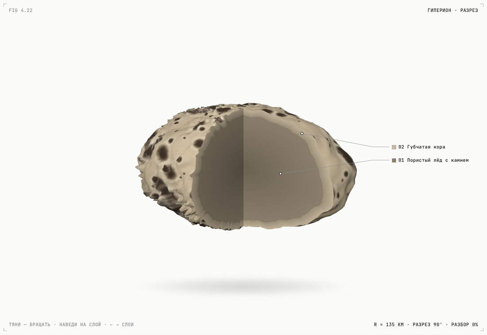

# Анатомия Солнечной системы · 3D-атлас для детей

Интерактивный сайт: каждую планету и спутник можно **разрезать клином и разобрать на слои в 3D**, чтобы увидеть, из чего они состоят. Отдельно — **все 120 спутников Юпитера и Сатурна с именами** (57 + 63), их семейства, орбиты в 3D и ещё 211 безымянных (всего 97 у Юпитера и 274 у Сатурна, данные на 2025 год).

Стиль фигур вдохновлён скиллом [wheresryan22/anatomy](https://github.com/wheresryan22/anatomy): карточка «Fig n», заголовок, подсказка и живые показания по углам, тонкие выноски, спокойное движение, светлая и тёмная темы.



## Что внутри

| Раздел | Что можно делать |
|---|---|
| **Fig 1 · Солнечная система** | Планеты движутся с настоящими периодами; управление временем, наведение, клик → разрез |
| **Fig 2 · Солнце, 8 планет, Луна** | Разрез клином, ступенчатая «разборка» слоёв, выноски с глубинами, характеристики, история, факты, викторина, сравнение размеров |
| **Fig 6 · Система Земли** | Луна и ≈12 000 искусственных спутников: станции, телескопы, GPS/ГЛОНАСС, Starlink, геостационар, точки Лагранжа, мусор. 28 аппаратов с 3D-моделями, которые разбираются на детали |
| **Fig 7 · Система Марса** | Фобос и Деймос почти в реальном масштабе, разрезы обоих спутников |
| **Fig 8 · Система Урана** | 29 спутников: 13 кольцевых, 5 крупных (подробные разрезы Миранды, Ариэля, Умбриэля, Титании, Оберона), 9 нерегулярных |
| **Fig 9 · Система Нептуна** | 16 спутников: Тритон с разрезом, Протей, Нереида и самые далёкие спутники в Солнечной системе |
| **Fig 3 · Система Юпитера** | 8 семейств, настоящие наклоны орбит, обратные спутники, сортируемый каталог |
| **Fig 4 · Система Сатурна** | Кольца, пастухи, троянцы, инуитская/галльская/скандинавская группы |
| **Подробные разрезы спутников** | Ио, Европа, Ганимед, Каллисто, Амальтея, Титан, Энцелад, Мимас, Тефия, Диона, Рея, Япет, Гиперион, Феба — и модели для всех остальных спутников с именами (неправильной формы, с хребтами у Пана и Атласа) |
| **История** | 35 событий: от Коперника и Галилея до JUICE, Europa Clipper и Dragonfly |




## Раздел «Вселенная» — полный гид

`#/universe` — 17 тем с отдельной 3D-моделью в стиле Anatomy (тёмная «космическая» карточка, выноски, живые показания, анимация):

| Группа | Темы и что показывает 3D |
|---|---|
| Как устроена Вселенная | Большой взрыв («колокол» истории с курсором времени), расширение пространства, тёмная материя (гало + кривая вращения), космическая паутина |
| Галактики | Млечный Путь (спиральная / эллиптическая / неправильная), квазары и джеты |
| Жизнь звёзд | Рождение звезды из облака, размеры звёзд от Проксимы до UY Щита, жизненный путь двух типов звёзд, разрезы красного гиганта и белого карлика |
| Останки звёзд | Сверхновая (звезда-«луковица» → взрыв), разрез нейтронной звезды, пульсар-маяк с сигналом, чёрная дыра с аккреционным диском и изогнутым светом |
| Миры и волны | Гравитационные волны со «чирпом», экзопланеты (транзит и лучевые скорости с графиком) |

Ещё: «История Вселенной за минуту», словарь из 57 терминов (`#/glossary`, с поиском), галерея 45 снимков телескопа «Джеймс Уэбб» (`#/gallery`) с подписями и полноэкранным просмотром.

Снимки: ESA/Webb, NASA, CSA, STScI — лицензия CC BY 4.0, авторство указано у каждого снимка; файлы в `img/webb/`.

## «Сейчас» — положения в реальном времени

Кнопка «● Сейчас» в меню (`#/live`) показывает, где всё находится в эту секунду, с живыми часами (местное время и UTC) и «машиной времени»: ±1 ч / ±1 сут, ускорение до 10 суток в секунду, ползунок на год вперёд и назад.

- **Планеты и спутники** — та же 3D-модель с фототекстурами, что на главной: планеты на своих местах в эту секунду, вокруг них все спутники — 163 с именами, безымянные облаками точек, Луна, спутники Плутона и искусственные спутники Земли (МКС, «Тяньгун», «Хаббл» по свежим TLE; GPS, ГЛОНАСС, геостационарные, Starlink, «Уэбб» и «Евклид» в L2, SOHO в L1). Выбери планету — камера подлетит к её системе, ниже появится трекер всех её спутников. Нажми на любой объект — карточка онлайн (`js/track.js`): расстояние до Солнца, до Земли и до планеты, скорость сближения, скорость по орбите, свет, виток, вид с Земли и описание того, что с объектом происходит сейчас. Точно показаны планеты, Луна, галилеевы спутники и станции; у остальных спутников верны орбиты и периоды, место на орбите условное.
- **Луна** — фаза, процент освещённости, возраст, расстояние, созвездие и даты ближайших фаз (теория Меёса, гл. 47).
- **Спутники Юпитера** — вид в телескоп на Ио, Европу, Ганимед и Каллисто и график их движения на неделю (Меёс, гл. 44).
- **МКС и станции** — МКС, «Тяньгун» и «Хаббл» над 3D-Землёй, освещённой настоящим Солнцем: широта, долгота, высота, скорость, трасса на 50 минут. Орбиты (TLE) скачиваются из каталога NORAD при открытии страницы и считаются моделью SGP4 ([satellite.js](https://github.com/shashwatak/satellite-js), MIT); если сети нет — используется сохранённая копия.

## Экскурсия с голосовым гидом

Кнопка «Экскурсия с гидом» на главной (или «▶ Экскурсия» в меню) запускает тур на 3,5 минуты из 13 остановок: Солнце, Земля, её спутники и МКС, Марс, Юпитер, Ио, Европа, Сатурн, Энцелад, Тритон и история открытий. Гид сам переходит по страницам и в нужный момент речи разрезает планеты, раскладывает слои, подсвечивает их и переключает группы спутников. Внизу — субтитры с подсветкой слов и кнопки ⏮ ⏯ ⏭ ✕ (пробел — пауза, Esc — выход).

Озвучка: [OmniVoice](https://github.com/k2-fsa/OmniVoice) — движок [VoiceStudio](https://github.com/debpalash/VoiceStudio) (навык лежит в `.claude/skills/voicestudio`). Голос гида клонирован с первой озвучки и синтезирован локально, по одной фразе, с паузами между фразами. Каждую фразу проверяла Whisper large-v3-turbo: невнятные дубли синтезировались заново. Затем мастеринг по цепочке VoiceStudio «Broadcast»: срез низа 80 Гц, плавное выравнивание громкости по фразам, лёгкий EQ, лимитер, громкость −16 LUFS. Файлы — `audio/tour/*.mp3`, сценарий, тайминги действий и границы фраз (`seg`) — в `js/tour.js`. Ключи API на сайте не используются. Если звук не загрузится, субтитры идут по таймеру.

## Управление фигурой

- тянуть мышью / пальцем — вращать, колесо — масштаб;
- навести на слой или деталь — появится подпись с описанием; убрать курсор — она исчезнет (на телефоне — коснуться детали, коснуться пустого места — спрятать);
- у аппаратов: кнопки «＋ / －», «К детали», «Весь аппарат» и двойной клик по детали — камера подлетает к ней;
- ← → — переключать слои, ↑ ↓ — менять разрез, `E` — разобрать;
- при `prefers-reduced-motion` анимации отключаются.

## Запуск

Сайт статический, без сборки и зависимостей (Three.js 0.170 лежит в `js/vendor`).

```sh
python3 -m http.server 8000
# открыть http://localhost:8000
```

**GitHub Pages:** Settings → Pages → Deploy from a branch → `main` / `(root)`.

## Устройство кода

```
index.html            каркас, навигация, importmap для three
css/style.css         токены темы и стиль карточек-фигур
js/app.js             роутер (#/body/…, #/moon/…, #/system/…, #/history) и страницы
js/anatomy3d.js       разрез: оболочки-слои, клин, разборка, выноски, подсветка
js/solar3d.js         Fig 1 — Солнечная система из 3D-модели (models/solar-system.glb)
js/orrery.js          запасная схема Fig 1, если модель не загрузилась
js/live.js, live3d.js страница «Сейчас»: часы, машина времени, вкладки и 3D-сцены
js/ephem.js           эфемериды: планеты, Луна, галилеевы спутники
js/data/tle.js        запасные орбиты станций (TLE)
js/system3d.js        системы спутников (лог-шкала орбит, облака безымянных и группировок)
js/tour.js            экскурсия с голосовым гидом (сценарий, тайминги, панель)
audio/tour/           озвучка экскурсии (ElevenLabs)
js/cosmos3d.js        3D-сцены раздела «Вселенная»
js/data/universe.js   темы, словарь, хроника, подписи к снимкам «Уэбба»
img/webb/             снимки «Джеймса Уэбба» (ESA/Webb, CC BY 4.0)
js/sat3d.js           3D-модели аппаратов (МКС, Хаббл, Уэбб, GPS, Starlink…) с разборкой
js/textures.js        процедурные текстуры (шум на сфере, кратеры, полосы, вулканы)
js/thumb.js           миниатюры без WebGL
js/data/*.js          данные: тела и слои недр, каталог спутников, история
```

Солнце, восемь планет и Луна покрыты настоящими фотокартами из 3D-модели (`img/tex/*.webp`: 2048 px для компьютера и 1024 px для телефона) — в разрезах, системах спутников, миниатюрах и на Земле со станциями. Остальные спутники и тела нарисованы кодом. Строение недр — научные модели (NASA/JPL, ESA, миссии Galileo, Cassini–Huygens, Juno, InSight); для маленьких спутников слои — модель по плотности и типу тела. Тонкие слои на рисунке утолщены, настоящие глубины — в подписях.

## 3D-модель Солнечной системы

На главной (Fig 1) — модель «[Solar System animation](https://sketchfab.com/3d-models/solar-system-animation-b7c69a6b655b47c99f871d5ec5aee854)», автор Samer_Arab_S5, лицензия [CC BY 4.0](https://creativecommons.org/licenses/by/4.0/). Для сайта её уменьшили с 10,6 до 1,1 МБ (текстуры WebP 1024 px, без дублей геометрии, квантование), файл — `models/solar-system.glb`. Планеты из модели расставлены по настоящим положениям на сегодня (эфемериды JPL) и движутся с выбранной скоростью; свет идёт от Солнца, Луна облетает Землю.

## Настоящие 3D-модели: «Хаббл», «Джеймс Уэбб», чёрная дыра, Юпитер

- **«Хаббл»** (`models/hubble.glb`, 2 МБ) — подробная модель с текстурами фольги, поручней, солнечных батарей и логотипов. Исходник — FBX; в Blender текстуры заново привязаны к материалам (в FBX они лежали в «слоистых» текстурах, которые Blender не читает), модель разделена на 7 узлов для разборки (труба, главное и вторичное зеркала, приборный отсек, крышка, батареи, антенны), тяжёлые сетки упрощены до ≈150 тыс. треугольников.
- **«Джеймс Уэбб»** (`models/jwst.glb`, 1,5 МБ) — из `JWST.blend`. Процедурные материалы Blender заменены на совместимые с вебом: золотое зеркало, серебристые слои щита с картой складок, солнечные элементы. Пять слоёв щита при разборке расходятся по одному.
- **Чёрная дыра** (`models/blackhole.glb`, 1,4 МБ) — в теме «Чёрные дыры» раздела «Вселенная»: чёрное ядро, светящиеся слои изогнутого света (шейдер подсвечивает край) и вращающийся аккреционный диск.
- **Юпитер** — карта «Хаббла» OPAL 2015 (`heic1522a`, ESA/Hubble) вместо прежней: `img/tex/jupiter.webp` 4096 px и `jupiter-s.webp` 2048 px; на всех текстурах включена анизотропная фильтрация, чтобы края шара были чёткими.

Модели сжаты [gltfpack](https://github.com/zeux/meshoptimizer) (meshopt), декодер — `js/vendor/meshopt_decoder.module.js`, загрузчик — `js/glb.js`. На схемах «Система Земли» и «Сейчас» «Хаббл» и «Уэбб» показаны маленькими копиями этих моделей.

## Телефон горизонтально

Если на телефоне повернуть экран горизонтально, 3D-схема, на которую сейчас смотришь, раскрывается на весь экран (без шапки). На странице «Сейчас» поверх схемы остаются кнопки планет, часы и живая панель данных. Кнопка ✕ выходит из режима; при повороте обратно всё возвращается как было.
